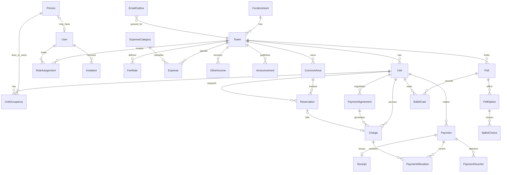

# ARCHITECTURE: ValleBlanco-Soft

> **Versión:** 0.7 (borrador de Fase 2; S0, S1, S2 y S3 completados; decisiones de tarifas, visibilidad de cargos, estado de cuenta y morosidad en la API de finanzas)
> **Estado:** pendiente de aprobación del cliente. Los puntos marcados con ⏳ requieren respuesta (ver `ROADMAP.md`, sección 13).
> **Base:** reglas de negocio del `ROADMAP.md` v1.2 y análisis del Excel de muestra `12-07_2026_TORRE_2.xlsx`.

---

## 1. Decisiones de arquitectura (ADR resumido)

| # | Decisión | Elegido | Motivo |
|---|----------|---------|--------|
| 1 | Estilo | **Monolito modular** (Django) + SPA Vue | Un solo VPS de 2 GB; sin microservicios |
| 2 | Idioma del código | Modelos, campos y endpoints en **inglés**; etiquetas y textos de UI en **español** | Convención estándar; interfaz en español vía `verbose_name` e i18n |
| 3 | Identificadores | **UUID v4** como clave primaria en tablas de dominio | Evita IDs secuenciales enumerables (defensa en profundidad contra IDOR; no reemplaza la autorización) |
| 4 | Dinero | `DecimalField(max_digits=12, decimal_places=2)`, moneda PEN; en la API como **string** (`"80.00"`) | Sin errores de coma flotante |
| 5 | Fechas | `USE_TZ=True`, zona `America/Lima`; periodos de cuota como **primer día del mes** | Consistencia y consultas simples |
| 6 | Autenticación | **Sesión de Django (cookie HttpOnly + CSRF)** | SPA y API comparten dominio (`torre2.arequipa.site`), así que no hace falta JWT y no hay tokens expuestos a JavaScript |
| 7 | Autorización | **RBAC** por roles + **filtrado por unidad** en cada queryset | Propietario e inquilino solo ven lo suyo |
| 8 | Saldos | **Derivados** de cargos, pagos y aplicaciones; nunca un campo editable | Auditable y sin descuadres |
| 9 | Anulación | Cargos y pagos se **anulan** (`VOID`), no se borran | Trazabilidad |
| 10 | Archivos (comprobantes) | Volumen Docker; descarga **solo vía Django** tras verificar permisos (`FileResponse`) | Nunca públicos; suficiente para 80 unidades |
| 11 | Correo | **Brevo SMTP** + tabla `EmailOutbox` + comando por `cron` | Sin Celery/Redis (RAM) y con reintentos |
| 12 | PDF | **WeasyPrint** (HTML/CSS → PDF) | Plantillas mantenibles; generación puntual, bajo consumo |
| 13 | Frontend | Vue 3 + **TypeScript** + Vite + Pinia + Vue Router + Tailwind | Tipado y estructura por *features* |
| 14 | Multi-torre | Todas las tablas de dominio cuelgan de `Tower` (que cuelga de `Condominium`) | Integración futura de las 8 torres sin rehacer el esquema |
| 15 | Configuración de negocio | Tablas de configuración en base de datos (tarifa, vencimiento, morosidad, mora, SUM) | Cambiar reglas sin redeploy |
| 16 | Versiones de entorno | **Python 3.12** y **PostgreSQL 16**, iguales en el PC de desarrollo, el CI y la VPS | Evita diferencias entre entornos |
| 17 | Base de datos por entorno | `DATABASES` usa PostgreSQL si existe `POSTGRES_DB`; si no, SQLite (solo desarrollo local). **El CI siempre usa PostgreSQL.** Lo que dependa de PostgreSQL (`ExclusionConstraint`, `select_for_update`, restricciones únicas parciales) se prueba contra PostgreSQL | SQLite no soporta esas funciones |
| 18 | Calidad y pruebas | `ruff check` + `ruff format --check`, `makemigrations --check`, `pytest` con cobertura ≥ 80 % (`backend/pytest.ini`); se ejecutan en cada Pull Request | Misma exigencia local y en CI |
| 19 | Modelo de usuario | `AUTH_USER_MODEL = "accounts.User"` se declara en S1, **antes** de la primera migración de `accounts` y de cualquier modelo que referencie al usuario. Se referencia siempre con `settings.AUTH_USER_MODEL` | Cambiarlo después obliga a reescribir migraciones |
| 22 | Perfil por registro | `/auth/me/` y el login obtienen roles y unidades de `core.profile`, donde cada app registra un proveedor (`properties` lo hace en `ready()`). `IsAdmin` significa tener el rol `ADMIN`: superusuario o `RoleAssignment`. Propietario e inquilino se derivan de las ocupaciones vigentes | `accounts` no puede importar `properties`; así la dependencia sigue yendo de izquierda a derecha |
| 23 | Titular principal y ocupaciones | Designar un nuevo titular principal (al crear o por `PATCH`) **reemplaza** al anterior, que sigue como copropietario. No se puede quitar el titular sin designar otro, pero sí cerrar su ocupación (venta). La fecha de cierre no puede ser futura ni anterior al inicio. Las restricciones viven en la base de datos | Una unidad no queda con dos votantes y el historial de ocupaciones se conserva |
| 24 | Códigos de unidad y carga inicial | `seed_tower` crea la torre con código = piso + número de 2 cifras (`101`…`1008`) y es repetible. `Unit.billing_start` es opcional hasta que la importación lo informe | La numeración real saldrá del Excel final; no se bloquea S2 esperándolo |
| 25 | Convenciones de la API de propiedades | Paginación de 25 desde `core.pagination`; filtros por parámetros sin `django-filter` por ahora; unidades ajenas devuelven 404 (no 403) para no revelar su existencia. Endpoints añadidos: `POST /people/{id}/invite/` y `/role-assignments/` | Sin ellos no había forma de enlazar una persona con su cuenta ni de dar roles |
| 26 | Alcance del rol ADMIN por torre | Mientras el MVP tenga una sola torre, `ADMIN` en cualquier torre vale como administrador global | Se acotará por torre cuando existan las 8 torres |
| 27 | Alta de tarifas | `POST /fee-rates/` exige `tower`, solo admite `ORDINARY_FEE` y una fecha de inicio posterior a la última tarifa de esa torre y concepto. Cierra la tarifa abierta anterior el día previo y rechaza superposiciones | Hay una sola tarifa vigente por mes y los cargos ya emitidos no cambian |
| 28 | Cargos visibles por rol | Administración, junta y tesorería ven todos los estados. Propietario e inquilino ven solo los cargos de sus unidades con ocupación vigente y nunca los `VOID`. Filtrar por una unidad ajena o inexistente devuelve 404; un valor mal formado, 400 | Mismo criterio de IDOR de la decisión 25 |
| 29 | Estado de cuenta (JSON) | No se pagina. Excluye los cargos `VOID` y acepta `as_of` (por defecto, hoy). Cada línea trae monto, aplicado, pendiente y si está vencida; el resumen trae saldo, vencido, meses de deuda, umbral y si es moroso. Solo los cargos `OPEN` deben algo | El saldo a favor llega con S4; `allocated_totals` es el único punto que se reemplaza |
| 30 | Reporte de morosidad | `GET /reports/delinquency/` (A, J, T) no se pagina (máximo 80 unidades por torre), acepta `tower` y `as_of` e informa el umbral de cada torre. Propietario e inquilino reciben 403 | El umbral se configura en `FinanceSettings` |
| 31 | Errores de la API de finanzas | 400 `validation_error` (campos), `invalid_charge`, `invalid_fee_rate`, `invalid_period`; 409 `charge_exists`, `charge_not_open`, `charge_has_allocations`, `fee_rate_not_found`. `generate` es idempotente y siempre responde 200 | Un conflicto de estado no es un error de formato |
---

## 2. Hallazgos del Excel de muestra y su impacto en el diseño

El archivo contiene 7 hojas. Los nombres de personas son datos personales y **no deben subirse a GitHub**; los usaré solo como estructura.

| Hallazgo | Impacto |
|----------|---------|
| **80 unidades** con código de 3 o 4 dígitos: `101…108`, `201…208`, …, `1001…1008` | `Unit.code` es texto único por torre; piso = `code // 100`, número = `code % 100` |
| `PROPIETAROS` tiene **160 filas** (las 80 unidades aparecen dos veces; la segunda copia sin ID) | El importador **deduplica por código de unidad**, nunca por `ID` |
| Los nombres vienen inconsistentes (nombre/apellido invertidos, apellidos truncados, mayúsculas distintas entre hojas) | `Person.full_name` canónico + revisión manual en el reporte de importación |
| **No hay correo, teléfono ni DNI** en ninguna hoja | ✅ Se importan residentes sin esos datos; `Person.email` y `Person.phone` son opcionales y la administración los completa después (`PATCH /people/{id}/`). Sin correo no se puede invitar al usuario |
| `PAGOS`: matriz de **80 unidades × 70 meses** (mar-2019 a dic-2024) con estado `PAGO` / `DEBE` / `NC`, **sin montos ni fechas** | Historial anterior a 2024 solo tiene estado; se importa como cargos con pago "histórico" |
| Estado `NC` (206 celdas) coincide con los meses anteriores a que la unidad empezara a pagar | `Unit.billing_start` (primer mes cobrable); ✅ `NC` = "no corresponde cobrar" |
| **156 celdas de estado vacías** (solo en la muestra) | ✅ El Excel final no tendrá celdas vacías (las no cobrables irán como `NC`). Si aparece alguna, se reporta como advertencia y no se adivina |
| `ESTADO DE CUENTA`: movimientos bancarios **ene-2024 a abr-2025** con fecha, glosa, gasto o ingreso | Fuente de **pagos con detalle** y **gastos** desde 2024 |
| Glosas de ingreso como `506 ENE2024`, `505 \| JUL AGO SET`, `1006 OCT-NOV-DIC 2023` | El importador interpreta **unidad + meses** con expresiones regulares; ~88 % coincide, el resto va a revisión |
| ~58 ingresos sin unidad (devoluciones, donaciones, macetas) | Entidad `OtherIncome` |
| Tipos de glosa bancaria: transferencias, `DEPOSITO AG`, `TRAN.CEL.BM` (banca móvil), `DEP.EN EFECTIVO` | Mapa glosa → método de pago. ✅ `DEP.EN EFECTIVO` es un depósito en la cuenta y cuenta como **Depósito** |
| Gastos: SEAL (luz), ascensor Schindler, impuesto ITF, comisión de cuenta, materiales, maestros | Categorías de gasto iniciales |
| Saldo inicial `7,527.04` el 26-ene-2024 ("cuenta anterior") | Configuración `opening_balance` del fondo |
| `RESUMEN DEUDORES`: es **moroso** quien debe **4 o más meses** (`M+4`); deuda total de muestra S/ 46,800 = 585 cuotas | Regla `delinquency_threshold = 4`, configurable |
| `Directorio`: teléfonos, cuenta bancaria, **códigos de candados** | Datos sensibles: **jamás en el repositorio**; módulo "Directorio" queda para backlog con acceso restringido |
| Los datos terminan en dic-2024 (matriz) y abr-2025 (banco), pero el sistema arranca en **nov-2026** | ✅ El Excel final traerá todos los pagos de todos los años; no hace falta saldo inicial por unidad |

---

## 3. Estructura del monorepo

```
valleblanco-soft/
├── ROADMAP.md  ARCHITECTURE.md  DEPLOYMENT.md  SECURITY.md
├── .github/workflows/        # ci.yml, deploy.yml
├── docker-compose.yml        # desarrollo
├── docker-compose.prod.yml   # producción (sin hot-reload, puertos a 127.0.0.1)
├── .env.example              # variables sin secretos reales
├── .gitignore                # incluye .env, *.xlsx, data/, media/
├── scripts/
│   └── excel_to_csv.py       # convierte el Excel actual a las plantillas CSV normalizadas
├── backend/
│   ├── Dockerfile
│   ├── pyproject.toml / requirements/{base,dev,prod}.txt
│   ├── manage.py
│   ├── config/               # settings/{base,dev,prod}.py, urls.py, wsgi.py
│   └── apps/
│       ├── core/             # base models, AuditLog, configuración, permisos, utilidades
│       ├── accounts/         # User, invitaciones, roles
│       ├── properties/       # Condominium, Tower, Unit, Person, UnitOccupancy
│       ├── finances/         # cargos, pagos, aplicaciones, recibos, gastos, convenios
│       ├── communications/   # comunicados y EmailOutbox
│       ├── reservations/     # áreas comunes y reservas (SUM)
│       ├── voting/           # votaciones
│       └── imports/          # importación CSV (lotes, validación, dry-run)
└── frontend/
    ├── Dockerfile
    ├── vite.config.ts  tailwind.config.ts  package.json
    └── src/                  # ver sección 9
```

### Dependencias permitidas entre apps (sin ciclos)

```
core  ◄── accounts ◄── properties ◄── finances ◄── reservations
                            ▲              ▲
                            ├── communications
                            ├── voting
                            └── imports (usa properties y finances)
```

Una app solo importa de las que están a su izquierda. `reservations` genera un `Charge` mediante un **servicio** de `finances`, nunca tocando sus modelos directamente. Así cada app se puede clonar o extender sin arrastrar a las demás.

---

## 4. Modelo Entidad-Relación



### 4.1 `accounts`

| Entidad | Campos clave | Reglas |
|---------|--------------|--------|
| `User` | `id`, `email` (único, login), `password`, `is_active` | Se crea solo por invitación o por la administración |
| `Invitation` | `user`, `token_hash`, `expires_at`, `accepted_at`, `invited_by` | Token de un solo uso, vence en 72 h, se guarda solo el *hash* |
| `RoleAssignment` | `user`, `role` (`ADMIN`, `BOARD`, `TREASURER`), `tower` | El **tesorero es un cargo de la junta**: `TREASURER` implica los permisos de `BOARD` |

Los roles **Propietario** e **Inquilino** **no se almacenan**: se derivan de `UnitOccupancy` activas. Así no pueden quedar desactualizados al vender o alquilar una unidad.

### 4.2 `properties`

| Entidad | Campos clave | Reglas |
|---------|--------------|--------|
| `Condominium` | `name` | Hoy un registro |
| `Tower` | `condominium`, `name`, `floors` | Hoy: "Torre 2" |
| `Unit` | `tower`, `code` ("101"), `floor`, `number`, `billing_start` (date), `is_active` | `UNIQUE(tower, code)` |
| `Person` | `full_name`, `first_names`, `last_names`, `doc_type`, `doc_number`, `email`, `phone` | Existe aunque no tenga usuario; `user` (1:1 opcional a `accounts.User`) vive aquí para respetar la dependencia `accounts ◄ properties`. `email` y `phone` son opcionales y editables por la administración |
| `UnitOccupancy` | `unit`, `person`, `relation` (`OWNER` / `TENANT`), `is_primary`, `start_date`, `end_date` | **Un solo titular principal vigente por unidad** (restricción única parcial). El titular principal recibe el recibo y es quien **vota**. 🟡 `CheckConstraint`: `is_primary` solo es válido si `relation = OWNER`, así una unidad nunca queda sin votante |

### 4.3 `finances`

| Entidad | Campos clave | Reglas |
|---------|--------------|--------|
| `FinanceSettings` | `tower`, `due_rule` (`END_OF_MONTH`), `delinquency_threshold` (4), `late_fee_enabled` (false), `late_fee_type/value`, `early_discount_enabled` (false), `opening_balance`, `opening_balance_date` | Mora y descuento **desactivados** pero previstos |
| `FeeRate` | `tower`, `concept`, `amount`, `valid_from`, `valid_to` | Cambiar la tarifa no altera cargos ya emitidos. Hoy: `ORDINARY_FEE` = 80.00 |
| `Charge` | `unit`, `concept`, `period`, `description`, `amount`, `due_date`, `status` (`OPEN`, `VOID`, `REFINANCED`), `source` (`SYSTEM`, `MANUAL`, `IMPORT`), `agreement`, `reservation` | `UNIQUE(unit, concept, period)` para `ORDINARY_FEE` (generación **idempotente**) |
| `Payment` | `unit`, `amount`, `method` (`TRANSFER`, `DEPOSIT`, `YAPE`, `PLIN`, `LEGACY`), `operation_number`, `paid_at`, `status` (`PENDING`, `APPROVED`, `REJECTED`, `VOID`), `submitted_by`, `reviewed_by`, `reviewed_at`, `rejection_reason`, `source` | No hay método efectivo. `LEGACY` solo para historial importado sin detalle |
| `PaymentVoucher` | `payment`, `file`, `sha256`, `content_type`, `size` | Detecta imágenes repetidas por `sha256` |
| `PaymentAllocation` | `payment`, `charge`, `amount` | `amount > 0`; suma por pago ≤ monto del pago; suma por cargo ≤ monto del cargo (validado con bloqueo de filas) |
| `Receipt` | `payment` (1:1), `number` (`R-2026-000123`), `issued_at`, `snapshot` (JSON) | Correlativo por año; el PDF se genera desde el *snapshot* inmutable |
| `ExpenseCategory` / `Expense` | `tower`, `date`, `category`, `description`, `supplier`, `amount`, `document`, `status` | Categorías iniciales: Energía común, Ascensor, Impuestos y comisiones bancarias, Materiales, Servicios de terceros, Otros. Los propietarios ven el detalle (proveedor, monto) y el comprobante si existe |
| `OtherIncome` | `tower`, `date`, `description`, `amount` | Devoluciones y donaciones |
| `PaymentAgreement` (convenio) | `unit`, `principal`, `installments_count`, `installment_amount`, `first_due_date`, `status`, `approved_by`, `notes` | **Interés = total pactado − principal**, y puede ser **0**. Al activarse, los cargos originales pasan a `REFINANCED` y se generan los cargos de cuota |

**Saldo a favor** = suma de pagos aprobados − suma de sus aplicaciones. No se guarda.

### 4.4 `communications`, `reservations`, `voting`

| Entidad | Campos clave | Reglas |
|---------|--------------|--------|
| `Announcement` | `tower`, `title`, `body`, `audience`, `published_at`, `pinned`, `author` | Al publicar, encola correos |
| `EmailOutbox` | `to`, `subject`, `body`, `template`, `status` (`PENDING`, `SENT`, `FAILED`), `attempts`, `last_error`, `scheduled_at`, `sent_at` | Reintentos con límite |
| `CommonArea` | `tower`, `name` ("SUM"), `rental_fee`, `deposit_amount`, `open_time`, `close_time`, `min_hours`, `max_hours`, `min_advance_days`, `max_advance_days`, `rules`, `is_active` | Todo **configurable** |
| `Reservation` | `area`, `unit`, `requested_by`, `starts_at`, `ends_at`, `status` (`REQUESTED`, `APPROVED`, `REJECTED`, `CANCELLED`, `COMPLETED`), `deposit_status` (`PENDING`, `RECEIVED`, `RETURNED`, `RETAINED`), `charge`, `decided_by` | **`ExclusionConstraint`** de PostgreSQL (`tstzrange` + `btree_gist`) impide solapamientos en `REQUESTED` y `APPROVED`. El alquiler genera un `Charge` (concepto `SUM_RENTAL`); la garantía **no** es ingreso |
| `Poll` | `tower`, `title`, `description`, `opens_at`, `closes_at`, `quorum_pct`, `majority_pct`, `is_secret`, `require_good_standing`, `status`, `results_snapshot` | Quórum y mayoría **configurables según reglamento**. `require_good_standing` por defecto `false` ⏳ |
| `PollOption` | `poll`, `label`, `position` | |
| `BallotCast` | `poll`, `unit`, `voter`, `cast_at` | **`UNIQUE(poll, unit)`: un voto por unidad**; solo el titular principal propietario |
| `BallotChoice` | `poll`, `option` | **Sin vínculo al votante** cuando el voto es secreto |

### 4.5 `core`

`AuditLog` (quién, qué acción, sobre qué entidad, cambios, IP, fecha): se registra aprobación y rechazo de pagos, anulaciones, cambios de tarifa, convenios, importaciones y cambios de roles. Es de **solo escritura**. El actor se guarda como texto (`actor_id`, `actor_label`), sin clave foránea, para que la auditoría sobreviva si se desactiva o borra un usuario.

---

## 5. Reglas de dominio

### 5.1 Generación de cargos mensuales
- Un comando/servicio `generate_monthly_charges(period)` crea un `ORDINARY_FEE` por cada unidad activa con `billing_start ≤ period`, usando la `FeeRate` vigente.
- **Idempotente:** ejecutarlo dos veces no duplica (restricción única).
- Vencimiento: **último día del mes** del periodo. Se programa con `cron` el día 1.
- Aplicación automática de saldo a favor existente al crear el cargo.

### 5.2 Aplicación de pagos (cargo más antiguo primero)
1. Al **aprobar** un pago se bloquean (`select_for_update`) los cargos abiertos de la unidad.
2. Se asigna el monto a los cargos por `due_date` ascendente, hasta agotar el pago.
3. El excedente queda como saldo a favor; los pagos **parciales** dejan el cargo con saldo pendiente.
4. Si la glosa o el pago indica periodos concretos (importación), se respeta esa asignación.

### 5.3 Morosidad
`meses_de_deuda` = cantidad de cargos vencidos con saldo pendiente. **Moroso** si `meses_de_deuda ≥ delinquency_threshold` (4, configurable) ⏳.

### 5.4 Convenio de pago (refinanciamiento)
1. La administración elige la deuda a refinanciar (cargos vencidos) y pacta **N cuotas** y el **monto de cada una** con el propietario.
2. `interés = N × cuota − principal`; se permite 0. No se permite un total menor al principal sin autorización explícita.
3. Al activar: cargos originales → `REFINANCED`; se crean N cargos `AGREEMENT_INSTALLMENT` con vencimientos mensuales.
4. Incumplimiento: el convenio pasa a `DEFAULTED` y la administración decide; no se revierte automáticamente.

### 5.5 Mora y descuento (previstos, desactivados)
Servicios `compute_late_fee()` y `compute_early_discount()` existen detrás de `FinanceSettings`. Con la configuración actual devuelven 0 y **no generan cargos**.

### 5.6 Votaciones
- Un voto por unidad; **solo el titular principal propietario** de la unidad vota; los inquilinos no.
- Resultado = quórum alcanzado **y** mayoría mínima, con los porcentajes de `Poll` y base de **80 unidades**.
- Al cerrar se congela `results_snapshot`. Antes de usar votaciones con efecto vinculante, **validar con asesor legal** la validez del voto electrónico frente al reglamento y la Ley 27157.

---

## 6. API REST (`/api/v1/`)

**Convenciones:** sesión + CSRF; JSON; dinero como string; paginación de 25; filtros con `django-filter`; errores `{ "code", "detail", "errors" }`; OpenAPI con `drf-spectacular`; *throttling* en login y subida de archivos.

**Roles:** `A` Administrador · `T` Tesorero · `J` Junta (incluye T) · `P` Propietario · `I` Inquilino · `auth` cualquier autenticado · *(propio)* solo sus unidades.

### Autenticación y usuarios
| Método | Ruta | Descripción | Roles |
|--------|------|-------------|-------|
| GET | `/auth/csrf/` | Cookie CSRF | público |
| POST | `/auth/login/` | Inicio de sesión (con límite de intentos) | público |
| POST | `/auth/logout/` | Cierre de sesión | auth |
| GET | `/auth/me/` | Usuario, roles y unidades | auth |
| POST | `/auth/password-reset/` y `/confirm/` | Recuperación de contraseña | público |
| POST | `/auth/invitations/accept/` | Aceptar invitación y crear contraseña | público (token) |
| GET/POST | `/users/` | Listar / crear e invitar | A |
| PATCH | `/users/{id}/` | Activar, desactivar, cambiar roles | A |
| POST | `/users/{id}/resend-invitation/` | Reenviar invitación | A |

### Propiedades
| Método | Ruta | Descripción | Roles |
|--------|------|-------------|-------|
| GET | `/units/` · `/units/{id}/` | Unidades | A, J (todas) · P, I (propias) |
| PATCH | `/units/{id}/` | Editar unidad | A |
| GET/POST/PATCH | `/people/` | Personas | A |
| GET/POST | `/units/{id}/occupancies/` | Propietarios e inquilinos de la unidad | A |
| PATCH | `/occupancies/{id}/` | Cambiar titular, cerrar ocupación | A |

### Finanzas
| Método | Ruta | Descripción | Roles |
|--------|------|-------------|-------|
| GET/POST | `/fee-rates/` | Tarifas | auth (lectura) · A (alta) |
| GET | `/charges/` | Cargos con filtros `unit`, `period`, `status` | A, J · P, I (propio) |
| POST | `/charges/` | Cargo manual o extraordinario | A |
| POST | `/charges/generate/` | Generar cargos del periodo (idempotente) | A |
| POST | `/charges/{id}/void/` | Anular cargo | A |
| GET | `/units/{id}/statement/` | Estado de cuenta (JSON) | A, J · P, I (propio) |
| GET | `/units/{id}/statement/pdf/` | Estado de cuenta (PDF) | A, J · P, I (propio) |
| GET | `/payments/` | Pagos con filtros | A, T, J · P, I (propio) |
| POST | `/payments/` | Registrar pago (residente) o a nombre de otro (A, T) | A, T, P, I |
| POST | `/payments/{id}/voucher/` | Subir imagen de comprobante | quien registró · A, T |
| GET | `/payments/{id}/voucher/` | Descargar comprobante | A, T · P, I (propio) |
| POST | `/payments/{id}/approve/` | Aprobar y aplicar | A, T |
| POST | `/payments/{id}/reject/` | Rechazar con motivo | A, T |
| POST | `/payments/{id}/void/` | Anular pago aprobado | A |
| GET | `/payments/{id}/receipt/pdf/` | Recibo PDF | A, T · P, I (propio) |
| GET | `/expenses/` · `/expenses/{id}/` | Gastos con detalle (proveedor, monto) | A, J, P |
| POST/PATCH | `/expenses/` · `/expenses/{id}/` | Registrar y editar gastos | A, T |
| GET | `/expenses/{id}/document/` | Descargar comprobante del gasto, si existe | A, J, P |
| GET | `/expense-categories/` | Categorías | auth |
| GET | `/reports/income-expense/` | Resumen mensual de ingresos y egresos | auth |
| GET | `/reports/delinquency/` | Morosidad | A, J |
| GET | `/reports/fund-balance/` | Saldo del fondo | A, J |
| GET/POST | `/agreements/` | Convenios | A, J (lectura) · P, I (propio, lectura) |
| POST | `/agreements/{id}/activate/` · `/cancel/` | Activar o cancelar convenio | A |

### Comunicación, reservas y votaciones
| Método | Ruta | Descripción | Roles |
|--------|------|-------------|-------|
| GET | `/announcements/` | Comunicados | auth |
| POST/PATCH/DELETE | `/announcements/` | Gestión | A, J |
| GET/PATCH | `/common-areas/` | Áreas comunes y su configuración | auth (lectura) · A (edición) |
| GET | `/reservations/` | Calendario (sin detalles ajenos) | auth |
| POST | `/reservations/` | Solicitar reserva | P, I |
| POST | `/reservations/{id}/approve/` · `/reject/` | Decidir | A |
| POST | `/reservations/{id}/cancel/` | Cancelar | A · solicitante |
| PATCH | `/reservations/{id}/deposit/` | Estado de la garantía | A |
| GET | `/polls/` · `/polls/{id}/` | Votaciones | auth |
| POST | `/polls/` · `/polls/{id}/open/` · `/close/` | Gestión | A, J |
| POST | `/polls/{id}/vote/` | Emitir voto | P (titular principal) |
| GET | `/polls/{id}/results/` | Resultados | auth tras el cierre |

### Administración
| Método | Ruta | Descripción | Roles |
|--------|------|-------------|-------|
| POST | `/imports/dry-run/` | Validar CSV sin guardar | A |
| POST | `/imports/commit/` | Importar | A |
| GET | `/imports/{id}/` | Reporte del lote | A |
| GET | `/audit-log/` | Auditoría | A |
| GET | `/health/` | Estado del servicio (sin datos sensibles) | público |

---

## 7. Importación CSV

### 7.1 Flujo
```
Excel original ──► scripts/excel_to_csv.py ──► 7 CSV normalizados ──► importador (dry-run) ──► reporte ──► commit
```
El importador **solo conoce los CSV normalizados**; el conversor es el único que conoce el formato del Excel. Si el Excel cambia, solo se ajusta el script.

**Propiedades del importador:** transaccional, **idempotente** (`ImportBatch` guarda el hash del archivo y claves naturales), modo simulación, reporte por fila (OK / advertencia / error), orden fijo de carga: `units` → `people` → `occupancies` → `charges` → `payments` → `expenses` → `other_income`.

### 7.2 Plantillas

| Archivo | Columnas | Observaciones |
|---------|----------|---------------|
| `units.csv` | `tower`, `unit_code`, `floor`, `number`, `billing_start` (`YYYY-MM`) | `billing_start` = primer mes no `NC` |
| `people.csv` | `person_ref`, `full_name`, `doc_type`, `doc_number`, `email`, `phone` | `email` y `phone` opcionales; se completan después en el sistema. Sin `email` no se puede invitar al usuario |
| `occupancies.csv` | `unit_code`, `person_ref`, `relation`, `is_primary`, `start_date`, `end_date` | Una fila titular principal por unidad |
| `charges.csv` | `unit_code`, `concept`, `period`, `amount`, `due_date`, `legacy_paid` | `legacy_paid=true` → pago histórico sin detalle (`LEGACY`) |
| `payments.csv` | `payment_ref`, `unit_code`, `paid_at`, `amount`, `method`, `operation_number`, `periods` (`2024-05\|2024-06`), `bank_description` | Fila sin `periods` → se aplica al más antiguo |
| `expenses.csv` | `date`, `category`, `description`, `supplier`, `amount`, `bank_description` | Sin categoría → "Sin clasificar" |
| `other_income.csv` | `date`, `description`, `amount`, `bank_description` | |

Ejemplo (datos ficticios):
```csv
unit_code,concept,period,amount,due_date,legacy_paid
101,ORDINARY_FEE,2023-05,80.00,2023-05-31,true
105,ORDINARY_FEE,2023-06,80.00,2023-06-30,false
```

### 7.3 Reglas de conversión del Excel
- `RESUMEN DEUDORES` y `PROPIETAROS` → `units.csv`, `people.csv`, `occupancies.csv` (deduplicadas por código).
- `PAGOS`: `PAGO` → cargo con `legacy_paid=true` (si el mes es anterior a 2024) · `DEBE` → cargo abierto · `NC` → sin cargo · vacío → advertencia.
- `ESTADO DE CUENTA` (ingresos con unidad) → `payments.csv`, interpretando `unidad + meses` de la glosa; mapa de método: `TRAN.CEL.*` → banca móvil, `DEPOSITO*` y `DEP.EN EFECTIVO` → `DEPOSIT`, `TRANSF.*` / `TRAN.CTAS.*` → `TRANSFER`.
- `ESTADO DE CUENTA` (gastos) → `expenses.csv`, categoría por palabras clave (`SEAL`, `ASCE`, `SCHINDLER`, `IMPUESTO ITF`, `MANT. CUENTA`).
- Ingresos sin unidad → `other_income.csv`.
- **Conciliación:** el importador compara, mes a mes, lo importado contra la columna de saldo del banco y reporta diferencias.
- Hojas `CUADRO BASE`, `MINIGRAFICOS` y `Directorio` **no se importan** (derivadas o sensibles).

---

## 8. Seguridad transversal

- Cookies de sesión `HttpOnly`, `Secure`, `SameSite=Lax`; CSRF activo; `SECURE_HSTS_SECONDS`, `X_FRAME_OPTIONS=DENY`, CSP estricta en Nginx.
- Contraseñas con validadores de Django y Argon2; límite de intentos de login por IP y por cuenta.
- Cada `ViewSet` filtra su `queryset` por las unidades del usuario; **pruebas de IDOR obligatorias** por endpoint.
- Subida de comprobantes: tipo real por contenido (no por extensión), máximo 5 MB, nombre aleatorio, almacenamiento fuera del directorio público, `sha256` para duplicados.
- Secretos solo en variables de entorno y *GitHub Secrets*; `.env`, `*.xlsx` y `media/` en `.gitignore`.
- `AuditLog` en operaciones sensibles. Detalle completo en `SECURITY.md` (Fase 4).

---

## 9. Estructura del frontend (Vue 3 + TypeScript)

```
frontend/src/
├── main.ts  App.vue
├── app/
│   ├── router/ (index.ts, guards.ts)      # guards por rol y por autenticación
│   └── layouts/ (AuthLayout, AppLayout)
├── core/
│   ├── api/ (http.ts, errors.ts)           # cliente con CSRF y manejo de errores
│   ├── stores/ (session.ts)                # Pinia: usuario, roles, unidades
│   └── utils/ (money.ts, dates.ts)         # dinero como string/decimal, fechas Lima
├── design-system/
│   ├── tokens.css                          # colores, tipografía, espaciado (variables CSS)
│   └── components/ (BaseButton, BaseInput, BaseTable, StatusBadge, FileDropzone, ConfirmDialog…)
├── features/
│   ├── auth/            (login, aceptar invitación, recuperar contraseña)
│   ├── properties/      (unidades, personas, ocupaciones)
│   ├── finances/        (estado de cuenta, pagar, revisar pagos, cargos, gastos, resumen, convenios, recibos)
│   ├── communications/  (comunicados)
│   ├── reservations/    (calendario SUM, solicitud, aprobación)
│   ├── voting/          (votaciones y resultados)
│   └── admin/           (usuarios, importación, configuración, auditoría)
│       └── cada feature: api.ts · types.ts · store.ts · components/ · views/ · __tests__/
└── tests/e2e/           # Playwright
```

### Rutas principales
| Ruta | Vista | Acceso |
|------|-------|--------|
| `/login`, `/invitacion/:token`, `/recuperar` | Autenticación | público |
| `/` | Panel: saldo, próximos vencimientos, comunicados | auth |
| `/estado-de-cuenta` | Estado de cuenta de mi unidad | P, I |
| `/pagos/nuevo` | Registrar pago con comprobante | P, I |
| `/transparencia` | Resumen de ingresos y egresos; el detalle de gastos solo para A, J, P | auth |
| `/reservas` | Calendario del SUM | auth |
| `/votaciones` | Votaciones activas y resultados | auth |
| `/admin/pagos` | Revisión y aprobación de pagos | A, T |
| `/admin/unidades`, `/admin/cargos`, `/admin/gastos`, `/admin/convenios` | Gestión | A, T |
| `/admin/usuarios`, `/admin/importar`, `/admin/configuracion`, `/admin/auditoria` | Administración | A |

### Design system y accesibilidad
Tokens en variables CSS (colores con contraste ≥ 4.5:1, tamaños legibles, objetivos táctiles ≥ 44 px), modo claro/oscuro, navegación por teclado, etiquetas y mensajes de error asociados a cada campo, estados de carga y vacío en todas las listas. **Mobile-first**: la mayoría de residentes pagará desde el celular.

---

## 10. Estrategia de pruebas y CI

| Capa | Herramientas | Criterio |
|------|-------------|----------|
| Backend unitarias y de integración | `pytest`, `pytest-django`, `factory_boy` | TDD; cobertura ≥ 80 % por módulo |
| Contrato API | `drf-spectacular` + pruebas de esquema | OpenAPI siempre actualizado |
| Permisos / IDOR | Matriz rol × endpoint | Una prueba por celda crítica |
| Frontend | `vitest` + Vue Test Utils | Stores y componentes con lógica |
| E2E | Playwright | Login, pagar, aprobar, reservar, votar |
| Calidad | `ruff`, `mypy` (opcional), `eslint`, `vue-tsc` | Sin errores |
| Seguridad | `pip-audit`, `npm audit`, `bandit` | Sin vulnerabilidades altas |

**Pipeline CI (en cada Pull Request):** lint → tests backend con PostgreSQL de servicio → tests frontend → build → auditoría de dependencias. **Despliegue** (solo `main`): Fase 5.

---

## 11. Entregables del sprint S0 ✅ (completado)

`.gitignore`, `.env.example`, `docker-compose.yml`, `backend/Dockerfile`, `frontend/Dockerfile`, esqueleto `config/settings/{base,dev,prod}.py`, app `core` con modelo base y `AuditLog`, `ci.yml` mínimo y primera prueba (**RED**) de `/api/v1/health/`.

**Resultado:** app `core` con `BaseModel` y `AuditLog`, endpoint `/api/v1/health/`, 15 pruebas con cobertura 100 %, `Dockerfile`, `docker-compose.yml` y `ci.yml` (trabajos `backend` y `docker`).

---

## 12. Entregables del sprint S1 ✅ (completado)

App `accounts` con pruebas primero (RED → GREEN):

| Tarea | Descripción | Estado |
|-------|-------------|--------|
| T1 | Modelo `User` (`AUTH_USER_MODEL`) y `Invitation` | ✅ |
| T2 | `POST /users/` (crear e invitar; el enlace lo ve solo la administración) | ✅ |
| T3 | Aceptar invitación con validación de contraseña | ✅ |
| T4 | Login y logout por sesión con CSRF, límite de intentos y `GET /auth/me/` | ✅ |
| T5 | Permisos básicos (`IsAdmin`: `is_superuser` como administrador), `POST /users/` (crear e invitar; el enlace lo ve solo la administración) y `POST /auth/invitations/accept/` | ✅ |
| T6 | Registro en `AuditLog` de invitaciones (`INVITATION_CREATED`, `INVITATION_ACCEPTED`) y accesos (`LOGIN_SUCCEEDED`, `LOGIN_FAILED`, `LOGIN_BLOCKED`, `LOGOUT`). Los bloqueos se registran una sola vez por ventana. Nunca se guardan contraseñas ni tokens. Los cambios de roles se auditan desde S2 | ✅ |

`RoleAssignment` pasa a S2 (decisión 20). La recuperación de contraseña por correo queda para R2, porque depende de Brevo. `AuditLog` guarda el actor como texto (`actor_id`, `actor_label`), sin clave foránea.

**Resultado:** T1 a T6 hechas (103 pruebas, cobertura 99 %). De la tabla de `/users/` de la sección 6 solo está `POST`; `GET /users/`, `PATCH /users/{id}/` y `resend-invitation` quedan para una tarea posterior. Aceptar una invitación no inicia sesión: la persona entra después por `/auth/login/`. Las acciones de auditoría se escriben en `MAYÚSCULAS_CON_GUION_BAJO`.

**Pendiente para el despliegue (Fase 5):** declarar `TRUSTED_PROXY_COUNT = 1` en `prod.py` (detrás de Nginx) y pasar los contadores de intentos a una caché compartida entre los 2 workers de Gunicorn antes del día 1.

## 13. Entregables del sprint S2 ✅ (completado)

App `properties`, desarrollada en un solo ciclo de pruebas (RED → GREEN) para todo el sprint:
 
 | Parte | Contenido |
 |-------|-----------|
 | Modelos | `Condominium`, `Tower`, `Unit`, `Person`, `UnitOccupancy` y `RoleAssignment`, con sus restricciones en la base de datos (decisión 23) |
 | Servicios | Crear, cerrar y designar titular en ocupaciones; asignar y revocar roles; invitar a una persona y enlazar su cuenta |
 | API | `/units/`, `/people/` (con `/invite/`), `/units/{id}/occupancies/`, `/occupancies/{id}/` y `/role-assignments/`; propietarios e inquilinos solo ven sus unidades |
 | Perfil | `/auth/me/` y el login devuelven roles y unidades reales (decisión 22) |
 | Auditoría | `OCCUPANCY_CREATED`, `OCCUPANCY_CLOSED`, `PRIMARY_HOLDER_CHANGED`, `ROLE_ASSIGNED`, `ROLE_REVOKED`, `PERSON_CREATED`, `PERSON_UPDATED`, `PERSON_INVITED`, `UNIT_UPDATED` |
 | Carga inicial | `python manage.py seed_tower` crea la Torre 2 con sus 80 unidades (decisión 24) |
 
 **Resultado:** 255 pruebas en total, cobertura 99 %.
 
 **Pendiente heredado:**
 - Confirmar las restricciones de la base de datos con PostgreSQL en el CI; la verificación previa se hizo con SQLite.
 - Esquema OpenAPI (`drf-spectacular`) y filtros con `django-filter`, previstos en la sección 6 y aún no incorporados.
 - Si dos solicitudes crean a la vez personas con el mismo documento, la segunda devuelve 500 en lugar de 400.
 - `GET /users/`, `PATCH /users/{id}/` y `resend-invitation`.

## 14. Entregables del sprint S3 ✅ (completado)

App `finances`, en dos partes con ciclo RED → GREEN cada una:

| Parte | Contenido |
|-------|-----------|
| S3-A | Modelos `FinanceSettings`, `FeeRate` y `Charge` con restricciones en la base de datos. Servicios de generación mensual idempotente, cargo manual, anulación, saldos y morosidad. Comando `generate_charges` (se programa con `cron` el día 1) |
| S3-B | API de tarifas, cargos, generación, anulación, estado de cuenta y morosidad (decisiones 27 a 31). Servicios `create_fee_rate`, `pending_amounts` y `unit_statement` |

| Método | Ruta | Roles |
|--------|------|-------|
| GET / POST | `/fee-rates/` | auth (lectura) · A (alta) |
| GET / POST | `/charges/` | A, J, T (todos) y P, I (solo lo propio) · A (alta) |
| POST | `/charges/generate/` | A |
| POST | `/charges/{id}/void/` | A |
| GET | `/units/{id}/statement/` | A, J, T · P, I (propio) |
| GET | `/reports/delinquency/` | A, J, T |

Auditoría: `FEE_RATE_CREATED`, `CHARGES_GENERATED`, `CHARGE_CREATED` y `CHARGE_VOIDED`, con la IP del cliente. Las pruebas incluyen la matriz rol × endpoint (8 roles) y el aislamiento entre unidades (404).

**Resultado:** 565 pruebas en total (S3-A, 99; S3-B, 211), cobertura 99 %.

**Fuera de S3 (sigue previsto):**
- `Payment`, `PaymentVoucher`, `PaymentAllocation` y `Receipt` (S4 y S5); hasta entonces `allocated_totals` devuelve vacío y todo cargo abierto está pendiente por completo.
- `Charge.agreement` y `Charge.reservation` se crean con convenios (S8) y reservas (S9).
- Estado de cuenta en PDF, importación CSV, gastos y convenios.

**Pendiente heredado:**
- Confirmar las restricciones de la base de datos con PostgreSQL en el CI; la verificación se hizo con SQLite.
- Esquema OpenAPI (`drf-spectacular`) y `django-filter`: S3 valida los filtros con serializers y parámetros de la URL.
- `GET /users/`, `PATCH /users/{id}/` y `resend-invitation`.
- La carrera entre dos altas simultáneas de personas con el mismo documento (500 en lugar de 400).
